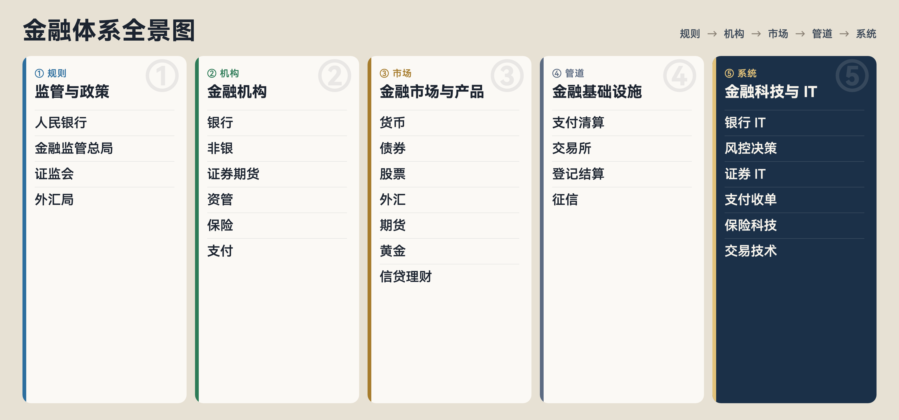

# 金融体系全景图

> 一张从上往下的地图：规则、机构、市场、基础设施，再到支撑它们的系统。适合想建立金融全局观的读者，尤其是金融 IT 与风控方向。

**阅读顺序**：规则 → 机构 → 市场 → 管道（基础设施）→ 系统（金融科技 / IT）

## 目录

- [① 监管与政策](#-监管与政策)
- [② 金融机构](#-金融机构)
- [③ 金融市场与产品](#-金融市场与产品)
- [④ 金融基础设施](#-金融基础设施)
- [⑤ 金融科技与 IT](#-金融科技与-it)
- [参考](#参考)

---

## ① 监管与政策

金融体系的「规则制定者与裁判」。先看谁管什么，再看机构怎么展业、系统怎么建设。

- **中国人民银行**：央行。负责货币政策、维护支付清算体系、征信管理、宏观审慎等。很多支付清算基础设施由其建设或主导。
- **国家金融监督管理总局**：主要监管银行、保险、金融资产管理公司、信托等非银行金融机构（原银保监会职能整合后）。
- **中国证监会**：监管证券市场、期货市场、证券基金经营机构等，覆盖发行、交易、信息披露与中介机构。
- **国家外汇管理局**：管理外汇收支、汇率相关政策与跨境资金流动，和外贸、跨境支付、结售汇密切相关。
- **地方金融监管 / 行业协会**：地方金融局等负责部分地方金融组织；协会（如银行业协会、证券业协会）承担自律与行业规范。

---

## ② 金融机构

直接面向客户提供金融产品与服务的经营主体。

### 银行业

- **政策性银行**：由国家发起，服务特定政策目标（如国家开发银行、进出口银行、农业发展银行），不以纯商业利润为唯一目标。
- **国有大型银行**：工农中建交邮储等，体量大、网点广、系统复杂，是银行 IT 建设的主要场景。
- **股份制商业银行**：全国性或区域性股份制银行，市场化程度较高，产品与渠道创新活跃。
- **城市商业银行**：以城市为根基的商业银行，服务地方经济与中小微客户。
- **农村商业银行 / 农信社**：服务县域与农村客群，机构数量多，IT 常有省联社统一建设模式。
- **村镇银行**：扎根县域的小型银行，定位普惠与本地化服务。
- **外资银行**：境外银行在华机构，业务与系统常需对接国内清算与监管要求。

### 非银行金融机构

- **消费金融公司**：专做个人消费贷款，不吸收公众存款（与银行不同），风控与获客是核心能力。
- **汽车金融公司**：围绕汽车销售的分期与贷款，常与主机厂、经销商深度绑定。
- **金融租赁**：以融资租赁方式提供设备 / 资产融资，兼顾融资与融物。
- **信托公司**：受托管理资产，可跨市场配置，产品结构相对复杂，监管约束严格。
- **财务公司**：企业集团内部的金融机构，服务集团成员单位的资金集中与结算。

### 证券与期货

- **证券公司 / 券商**：经纪、投行、自营、资管等业务，连接投资者与资本市场。
- **期货公司**：为客户提供期货经纪与相关服务，对接期货交易所。
- **期货资管**：期货公司开展的资产管理业务，属于资管业务在期货领域的延伸。

### 资产管理

接受客户委托，按约定进行投资运作并收取管理费。

- **公募基金**：向不特定公众募集，门槛低、披露规范，由基金公司管理。
- **私募基金**：向合格投资者非公开募集，策略更灵活，监管与披露要求不同于公募。
- **银行理财子公司**：银行体系下的资管机构，发行理财产品，与银行表内业务风险隔离。
- **保险资管**：保险公司旗下资管机构，主要管理保险资金及受托资金。
- **券商资管**：证券公司资产管理业务，覆盖集合、单一等资管计划。

### 保险

- **人寿保险**：以人的寿命和身体为标的，如定期寿险、终身寿险、年金等。
- **财产保险**：以财产及有关利益为标的，如车险、企财险、责任险。
- **健康 / 意外险**：医疗、重疾、意外伤害等保障型产品，常与寿险或专业健康险公司相关。
- **再保险**：保险公司之间转移风险的安排，「保险的保险」，用于分散巨灾与集中风险。

### 支付与清算相关机构

- **第三方支付机构**：持牌支付公司，提供网络支付、银行卡收单等；资金清算需走合规清算通道。
- **收单机构**：拓展商户、铺设受理终端 / 通道，处理商户侧交易与清算分润。
- **清算组织**：如银联、网联，偏基础设施属性：连接银行与支付机构，完成跨机构清算。

### 特定 / 跨境业态

这一类和国内银行、证券不是同一套分类，阅读时建议单独看。

- **外汇 / CFD Broker**：面向投资者提供外汇或差价合约交易服务，多见于境外监管框架。
- **Liquidity Provider（LP）**：向经纪商或平台提供报价与流动性，是交易链路中的价格与成交来源之一。
- **数字资产**：包括交易所（Exchange）、经纪（Broker）、托管（Custody）等角色，监管环境因司法辖区而异。

---

## ③ 金融市场与产品

机构在哪些「市场」交易什么「产品」。这是业务语言层。看系统之前，先建立这张图。

- **货币市场**：短期资金市场（如拆借、回购、短债），主要解决流动性与短期融资。
- **债券市场**：发行与交易国债、金融债、企业债、信用债等，是直接融资的重要渠道。
- **股票市场**：股权融资与二级市场交易，含主板、创业板、科创板、北交所等层次。
- **外汇市场**：货币兑换与外汇交易，连接跨境贸易、投资与结售汇。
- **衍生品 / 期货市场**：期货、期权等，用于套期保值、价格发现与风险管理（也有投机交易）。
- **黄金市场**：黄金现货、延期等交易，国内以上海黄金交易所为重要场所。
- **信贷 / 财富管理产品**：贷款、信用卡、理财、基金代销等面向零售与对公客户的产品形态。

---

## ④ 金融基础设施

市场能够运转的「管道与轨道」：支付走得通、交易能成交、登记能确权、清算能轧差(gá chà / netting)。

### 支付清算

- **大额支付系统（HVPS）**：处理大额、实时、逐笔的跨行支付，是金融机构之间资金调拨的主干道。
- **小额支付系统（BEPS）**：处理小额、批量的跨行支付，适合代发工资、批量扣费等高频小额场景。
- **网上支付跨行清算系统（IBPS）**：支持网银等渠道的跨行支付清算，是网上支付的重要基础设施。
- **中国银联**：银行卡跨行交易转接与清算的核心组织，连接发卡行、收单行与商户侧网络。
- **网联清算**：非银行支付机构网络支付清算平台，支付机构与银行之间的清算「总闸口」之一。

### 交易所

- **上交所 / 深交所 / 北交所**：证券集中交易场所，分别服务不同板块与企业发展阶段。
- **上期所 / 郑商所 / 大商所 / 中金所**：商品与金融期货交易所，提供标准化合约交易与相关清算安排。
- **上海黄金交易所**：黄金等贵金属交易的重要场所。

### 登记 / 托管 / 清算结算

- **中国结算**：证券登记结算机构，负责证券账户、登记、清算、交收等「确权与钱券对付」关键基础设施。
- **其他登记结算机构**：期货、黄金等领域也有对应的登记结算或清算安排。

### 征信与公共数据

**征信中心等**：汇集信贷等信用信息，为银行与持牌机构授信提供基础信用报告服务。

---

## ⑤ 金融科技与 IT

用系统支撑展业、风控、清算与监管报送。下面按业态分开看。银行自己建的风控系统，和独立的风控科技公司，是两类角色。

### 银行金融 IT

银行内部系统群，核心是「客户—账户—交易—账务」闭环。

- **核心银行系统**：银行最底层账务与产品能力：客户、账户、存款、贷款、计息、费用、总账等。稳定性与一致性要求极高。产品最集中的是 `长亮科技`、`神州信息`；`中电金信` 主打分布式核心，同时做银行整体解决方案。
- **信贷系统**：覆盖授信、放款、还款、贷后全流程，常与核心、风控、额度系统联动。`宇信科技`、`天阳科技`、`安硕信息` 更常出现在这条产品线上。
- **支付系统**：行内支付指令处理，以及对二代支付、银联、网联等外部清算通道的对接、对账与结算。
- **渠道系统**：柜面、ATM、个人 / 企业网银、手机银行等客户触达入口，最终交易仍会落到核心或支付。`科蓝软件` 擅长手机银行和网银，`南天信息` 擅长柜面与智慧网点；`宇信科技` 的渠道管理也是强项。
- **卡系统**：借记卡 / 信用卡开卡、授权、清算、积分与风控等相关能力。信用卡系统是 `天阳科技` 的传统强项。
- **银行内部风控系统**：行内建设的反欺诈、交易监控、授信风控等，服务于本行风险偏好与合规要求。
- **数据平台**：数仓、指标、标签、报表与监管报送的数据底座。
- **AI / 大模型**：智能客服、营销、研报助理、知识库、辅助审批等新兴能力，仍需落在合规与可控框架内。
- **金融云**：银行系统上云与云原生改造，涉及资源弹性、安全隔离与信创等要求。

### 风控 / 决策 / 数据科技

卖给银行和互金的数据、决策与模型能力，也可以嵌进业务中台。一次准入或支付，先取数据和特征，再进入决策引擎，由规则和模型给出通过、拒绝或人工复核。

- **征信应用**：接入并解读征信报告，同时使用多头借贷、履约等替代数据，服务准入与额度。征信报告来自征信机构。替代数据由评分公司提供，用来补充征信。
- **信贷风控**：贷前准入、贷中监控、贷后管理，用来控制信用风险与不良。`百融云创`、`冰鉴科技` 偏信贷评分和资质评估，`同盾科技` 覆盖信贷全流程风控。
- **反欺诈**：识别盗号、伪冒、团伙、设备篡改、异常交易，要跟着黑产手法持续更新。`同盾科技` 做交易和信贷场景的反欺诈，`数美` 更常见于注册登录、设备风险和营销作弊。
- **实时风控**：支付、登录、交易发生时做毫秒到秒级决策，规则和模型并行。银行侧的实时交易反欺诈，`邦盛科技` 是常见供应商。
- **规则引擎 / 决策引擎**：把业务策略配成可执行的决策流，调整策略时不用改核心代码。`邦盛科技`、`同盾科技` 都提供这类决策平台。
- **决策表 / 决策树 / 评分卡**：决策引擎里的三种写法。决策表对应一条条政策条款，决策树做层层分流，评分卡把多个因素合成一个分数。
- **模型平台 / 特征平台 / 数据平台**：负责模型训练与上线、特征生产与复用、底层数据供给，是量化风控的工程底座。`第四范式` 以机器学习平台见长，银行用它生产反欺诈、反洗钱等模型。

### 证券 / 资本市场 IT

服务券商、期货公司和资管机构，范围是国内市场。一笔委托从行情进入交易系统，成交后做持仓和风控，日终再清算；资管在交易之外还要做估值核算。

- **行情系统**：行情接入、分发；含 Tick、Level-2 等不同深度的行情数据。
- **交易系统**：报单、成交回报、柜台与集中交易。`恒生电子`、`金证股份` 是券商集中交易系统的两家主要供应商。`顶点软件` 也做交易系统，更突出的是券商客户关系管理和集中运营。`金仕达` 偏期货、贵金属交易和交易风险管理。
- **OMS（Order Management System）**：订单管理系统，管订单生命周期、合规检查和路由前的状态。
- **EMS（Execution Management System）**：执行管理系统，更贴近成交、执行算法和多市场执行。国内机构侧的订单和执行，常做进投资交易系统，`恒生电子` 这条产品线覆盖这一层。
- **风控引擎**：交易前和交易中的限额、持仓、集中度控制，通常嵌在交易系统里。
- **算法 / 量化**：把大单拆开执行，或按策略自动下单，对延迟和稳定性要求高。
- **资管系统**：组合管理、估值核算、投资监督。`恒生电子` 强在投资交易和组合管理；`赢时胜` 专注后端的估值核算和资产托管。
- **清算 / 结算**：日终清算、交收、资金与证券对账，连接登记结算机构。券商侧多随核心交易系统一起，由 `恒生电子`、`金证股份` 提供。

### 支付 / 收单科技

这里的公司多数自己持有支付或收单牌照，系统用来经营自己的商户网络。一笔收款由收单机构受理，经通道和网关完成支付，再清分、对账，按周期结算给商户。

- **支付机构系统**：余额、快捷等支付产品，以及备付金、反洗钱等合规能力。`汇付天下` 覆盖网上支付和行业支付，`连连数字` 以跨境支付见长，`海联金汇` 做互联网支付和银行卡收单。
- **收单 / 聚合支付**：对接多家通道，为商户提供统一收款。`银联商务` 是银行卡收单的主要机构，`拉卡拉`、`移卡` 面向中小商户做收单和聚合支付。
- **商户系统 / POS**：商户入网、终端和码牌、交易查询与对账。`新大陆` 以智能 POS 终端见长。
- **支付网关**：统一接入和路由，封装银行、银联、网联等通道。网关一般做在支付机构或收单机构自己的系统里。
- **清分 / 对账 / 结算**：按规则分润，与通道和商户对账，再按周期把资金结算出去。这三步同样落在上面的机构系统中。

### 保险科技

一张保单从产品定义、承保出单，到核保、理赔和续期。核心系统管住保单生命周期，风控和营销接在核心外面。

- **保险核心 / 产品 / 保单**：产品定义、承保出单、保单生命周期管理。`中科软` 是保险公司核心系统的主要供应商，承保、保单、理赔和收付都在这套系统里。
- **核保 / 理赔 / 精算**：风险筛选、赔案处理、定价与准备金。流程本身在核心系统中；`金融壹账通` 对外输出的是智能核保和智能理赔。
- **保险风控 / 营销**：投保反欺诈、理赔风险，以及获客与续期。`众安科技` 从互联网保险出来，做业务中台、智能理赔和营销获客。
- **保险数据平台**：保单、理赔、精算与经营分析的数据底座，通常随核心系统一起沉淀。

### 交易技术

外汇、经纪商与跨境场景，走的是 MT、LP、Bridge、A/B Book 这条技术栈。能对上厂商的主要是交易平台、桥和流动性；订单、风控、执行和行情，多半做进平台或桥里。

- **Trading Platform**：客户看到的交易终端和背后的服务器。`MetaQuotes` 的 MT4、MT5 是这一层最常见的产品，`Devexperts` 提供另一类白标交易平台。
- **OMS / EMS**：经纪商侧的订单管理和执行管理，把客户订单交到流动性一方。这块通常内置在交易平台中。
- **Risk（Pre-Trade / Margin / Exposure / Limit）**：交易前风控、保证金、敞口与限额，防止穿仓。平台和桥都会带这层检查。
- **Execution（Routing / SOR / Matching）**：订单路由、智能路由和撮合。跨流动性来源的路由，主要发生在桥上。
- **Market Data（Tick / Quote / Order Book）**：报价、Tick 和盘口。报价由流动性提供方给出，经桥聚合后送到终端。
- **Liquidity（LP / ECN / PB / Aggregator）**：流动性提供、电子通讯网络、主经纪商和流动性聚合。`B2Broker` 以向经纪商提供流动性和白标方案见长。
- **Bridge（MT5↔LP、A/B Book、Price Aggregation）**：交易平台和 LP 之间的桥，做价格聚合、订单转发和 A/B Book。`oneZero`、`PrimeXM`、`Gold-i` 是这一层的常见供应商。
- **Broker Tech（CRM / IB / KYC / Payment / Back Office）**：客户关系、代理、身份核验、出入金和后台账务。`Leverate`、`Match-Trade` 提供整套经纪商运营系统，`B2Broker` 也覆盖这一层。

---

按「规则 → 机构 → 市场 → 管道 → 系统」串起来，用来建立金融体系与金融 IT 的全局观。

---

## 参考

- [AI 时代，传统 IT 厂商路在何方｜金融软件厂商篇](https://mp.weixin.qq.com/s/BvRSdoe_pjURJnghi693wQ)，思想的猴子。对照银行软件厂商的产品型与人力外包型分法，以及信贷、渠道、分布式核心、柜面各自的主业。文思海辉 2020 年进入中国电子，服务品牌仍是[中电文思海辉](https://www.pactera.com/)；2021 年其金融业务品牌「文思海辉金融」升级为 `中电金信`。两边现在都在：前者偏全行业 IT 服务，后者偏金融软件产品。
